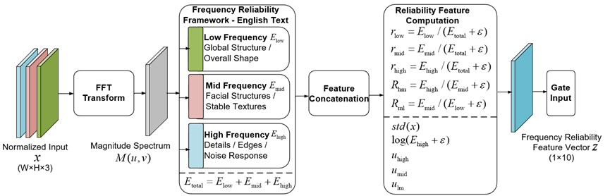

# Robust-GAN-Face-Detection

## FR-WSG: Frequency-Reliability Weak-Strong Expert Gate for Robust GAN-Generated Face Detection

This repository contains the implementation, training scripts, evaluation scripts, dataset-processing tools, figures, and experimental results for **robust GAN-generated face detection under Gaussian-noise degradation**.

The proposed method, **FR-WSG** (Frequency-Reliability Weak-Strong Expert Gate), improves robustness by combining:

- a 10-dimensional frequency-reliability feature vector;
- a weak-noise stability expert for clean and light-noise images;
- a strong-noise bias-calibration expert for moderate and strong-noise images;
- a frequency-reliability-aware gate for adaptive expert routing.

> 中文说明：本项目对应“基于频率感知的高斯噪声鲁棒生成式人脸图像检测方法”，提供模型代码、训练脚本、测试脚本、数据处理工具、实验结果和论文插图。

---

## Method Overview

FR-WSG first extracts frequency-reliability features from the input image. The gate then selects a suitable expert according to the estimated degradation level:

- **Weak-noise expert:** optimized for clean and lightly degraded images.
- **Strong-noise expert:** optimized for moderate and strong Gaussian noise.
- **Adaptive gate:** routes each input to the more suitable expert using frequency-domain reliability features.


### Frequency-Reliability Features

The frequency module decomposes the spectrum into low-, mid-, and high-frequency regions and constructs a 10-dimensional reliability vector for gate routing.



---

## Repository Structure

```text
Robust-GAN-Face-Detection/
├── figures/
├── model/
├── results/
│   ├── all_degradation_results.csv
│   ├── all_models_compute_efficiency_comparison.csv
│   ├── final_gate_and_experts_
