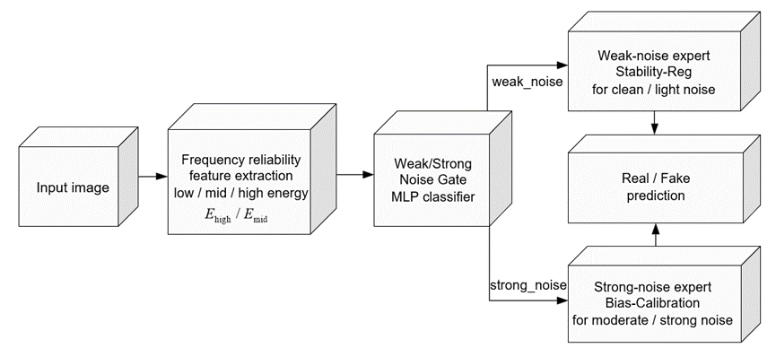
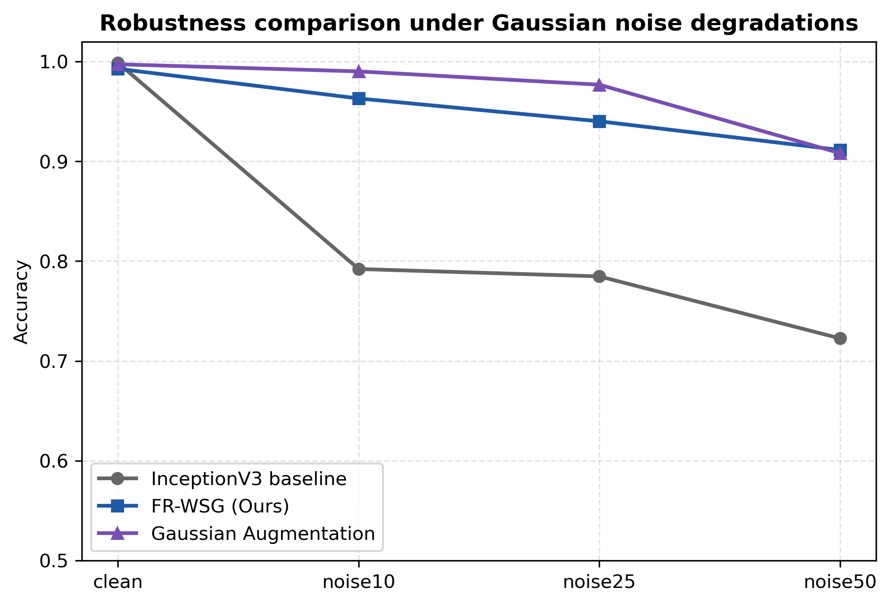
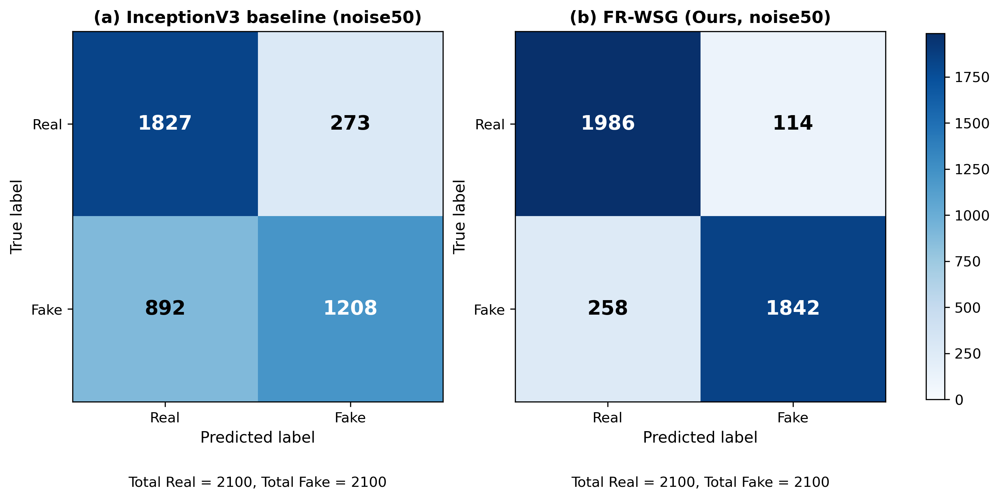

# Robust-GAN-Face-Detection

## FR-WSG: Frequency-Reliability Weak-Strong Expert Gate for Robust GAN-Generated Face Detection

This repository contains the implementation, training scripts, evaluation scripts, dataset-processing tools, figures, and experimental results for **robust GAN-generated face detection under Gaussian-noise degradation**.

The proposed method, **FR-WSG** (Frequency-Reliability Weak-Strong Expert Gate), improves robustness by combining:

- a 10-dimensional frequency-reliability feature vector;
- a weak-noise stability expert for clean and light-noise images;
- a strong-noise bias-calibration expert for moderate and strong-noise images;
- a frequency-reliability-aware gate for adaptive expert routing.

> 中文说明：本项目对应“基于频率可靠性感知弱强噪声专家门控的 GAN 生成人脸图像鲁棒检测方法”，提供模型代码、训练脚本、测试脚本、数据处理工具、实验结果和论文插图。

---

## Method Overview

FR-WSG first extracts frequency-reliability features from the input image. The gate then selects a suitable expert according to the estimated degradation level:

- **Weak-noise expert:** optimized for clean and lightly degraded images.
- **Strong-noise expert:** optimized for moderate and strong Gaussian noise.
- **Adaptive gate:** routes each input to the more suitable expert using frequency-domain reliability features.

The final routing strategy is:

```text
Clean / noise10
        ↓
Weak-noise route
        ↓
Stability-Regularization Expert

Noise25 / noise50
        ↓
Strong-noise route
        ↓
High-Noise Bias-Calibration Expert
```



### Frequency-Reliability Features

The frequency module decomposes the spectrum into low-, mid-, and high-frequency regions and constructs a 10-dimensional reliability vector for gate routing.


---

## Repository Structure

```text
Robust-GAN-Face-Detection/
├── figures/
├── model/
├── results/
│   ├── all_degradation_results.csv
│   ├── all_models_compute_efficiency_comparison.csv
│   ├── final_gate_and_experts_light_degradations.csv
│   ├── modern_strong_baselines_light_degradations.csv
│   ├── noise_only_all_models_summary.csv
│   ├── noise_only_all_models_summary.txt
│   ├── noise_only_results_weak_strong_gate.csv
│   ├── per_gan_summary.csv
│   ├── threshold_calibration_results.csv
│   ├── unseen_noise_results.csv
│   └── weak_strong_gate_confusion_matrix.csv
├── scripts_test/
│   ├── test_all_degradations.py
│   ├── test_all_models_compute_efficiency_comparison.py
│   ├── test_final_gate_active_path_efficiency.py
│   ├── test_final_gate_and_experts_light_degradations.py
│   ├── test_gaussian_aug_per_gan_noise.py
│   ├── test_inceptionv3_gaussian_noise_aug_degradations.py
│   ├── test_inceptionv3_threshold_calibration.py
│   ├── test_modern_strong_baselines_light_degradations.py
│   ├── test_noise_only.py
│   ├── test_per_gan_all_models_noise.py
│   └── test_unseen_gaussian_noise_strengths.py
├── scripts_tools/
│   ├── check_dataset_integrity.py
│   ├── preprocess_ffhq.py
│   └── split_fake_gan.py
├── scripts_train/
│   ├── train_convnext_tiny_server.py
│   ├── train_densenet121.py
│   ├── train_efficientnet_b3_server.py
│   ├── train_frequency_reliability_weak_strong_gate_server.py
│   ├── train_imagenet1k_timm_baseline_common.py
│   ├── train_inceptionresnetv2_server.py
│   ├── train_inceptionv3_high_noise_bias_calib_no_high_noise_gate_server.py
│   ├── train_inceptionv3_high_noise_bias_calib_server.py
│   ├── train_inceptionv3_nmfgf_noise_ra_stability_reg_server.py
│   ├── train_inceptionv3_server.py
│   ├── train_mobilenetv2.py
│   ├── train_noise_aware_expert_gate_server.py
│   ├── train_resnet50v2_server.py
│   ├── train_swin_tiny_server.py
│   ├── train_vgg16_server.py
│   ├── train_vgg19_server.py
│   └── train_xception_server.py
├── .gitignore
├── LICENSE
└── README.md
```

---

## Environment

The experiments were conducted with the following environment:

- Ubuntu 22.04
- Python 3.10
- PyTorch 2.3.1
- CUDA 12.1
- cuDNN 8
- NVIDIA RTX 4090D

Main Python dependencies include:

```text
torch
torchvision
timm
numpy
pillow
scikit-learn
tqdm
matplotlib
pandas
```

Install the required packages with:

```bash
pip install torch torchvision timm numpy pillow scikit-learn tqdm matplotlib pandas
```

Before running the scripts, update dataset paths, checkpoint paths, and output paths to match your local or server environment.

---

## Dataset

This project performs binary classification between real face images and GAN-generated face images.

The dataset is constructed from:

- real face images sampled from **Flickr-Faces-HQ (FFHQ)**;
- fake face images generated by **ProGAN**;
- fake face images generated by **StyleGAN2**;
- fake face images generated by **StyleGAN3**.

The original images are not redistributed in this repository. Users should download the datasets from their original public sources and comply with the corresponding licenses and terms of use.

### Real Face Images: FFHQ

The real face images are obtained from the official NVIDIA Research repository:

- **Dataset:** [Flickr-Faces-HQ Dataset (FFHQ)](https://github.com/NVlabs/ffhq-dataset)
- **Official download:** [`images1024x1024`](https://drive.google.com/drive/folders/1WvlAIvuochQn_L_f9p3OdFdTiSLlnnhv)
- **Related paper:** [A Style-Based Generator Architecture for Generative Adversarial Networks](https://arxiv.org/abs/1812.04948)

FFHQ contains 70,000 aligned and cropped face images in PNG format at a resolution of `1024×1024`.

This project uses **21,300 real images in total**. Specifically, the first 21,300 FFHQ images are selected according to the official numeric filename order:

```text
00000.png, 00001.png, ..., 21299.png
```

These 21,300 real images are divided sequentially into:

| Split | FFHQ filename range | Number of images |
|---|---|---:|
| Train | `00000.png`–`14999.png` | 15,000 |
| Validation | `15000.png`–`19199.png` | 4,200 |
| Test | `19200.png`–`21299.png` | 2,100 |
| **Total** | `00000.png`–`21299.png` | **21,300** |

In other words:

```text
15,000 + 4,200 + 2,100 = 21,300 real FFHQ images
```

The original FFHQ images are downloaded at `1024×1024` resolution and subsequently resized and center-cropped by the preprocessing and model input pipelines.

### GAN-Generated Fake Images

The fake face images are obtained from the following publicly available Kaggle dataset:

- **Dataset:** [Fake Face Images Generated From Different GANs](https://www.kaggle.com/datasets/mayankjha146025/fake-face-images-generated-from-different-gans)

This Kaggle dataset was introduced and made publicly available in the following paper:

> M. Wyawahare, V. Parkhi, S. Bhorge, M. Jha, M. Rane, and N. Muhal,  
> “Comparative Analysis of Deepfake Detection Models on Diverse GAN-Generated Images,”  
> *International Journal of Electrical and Computer Engineering Systems*,  
> vol. 16, no. 1, pp. 9–18, 2025.

The paper explicitly states that fake images were generated using three pretrained GAN models—ProGAN, StyleGAN2, and StyleGAN3—and that the newly generated dataset was made publicly available on Kaggle.

The original Kaggle dataset contains the following GAN-generated subsets:

```text
GAN_Generated_Fake_Images/
├── ProGAN_128x128/
├── ProGAN_256x256/
├── StyleGAN2_256x256/
└── StyleGAN3_256x256/
```

This project uses the following three `256×256` subsets:

- `ProGAN_256x256`
- `StyleGAN2_256x256`
- `StyleGAN3_256x256`

The selected fake images are independently reorganized into fixed training, validation, and test splits using the project dataset-processing script and a fixed random seed of `42`.

### Dataset Split

The final dataset contains an equal number of real and fake images in every split:

| Split | Real | Fake | Total |
|---|---:|---:|---:|
| Train | 15,000 | 15,000 | 30,000 |
| Validation | 4,200 | 4,200 | 8,400 |
| Test | 2,100 | 2,100 | 4,200 |
| **Total** | **21,300** | **21,300** | **42,600** |

Each fake-image split contains an equal number of samples from ProGAN, StyleGAN2, and StyleGAN3:

| Split | ProGAN | StyleGAN2 | StyleGAN3 | Total fake |
|---|---:|---:|---:|---:|
| Train | 5,000 | 5,000 | 5,000 | 15,000 |
| Validation | 1,400 | 1,400 | 1,400 | 4,200 |
| Test | 700 | 700 | 700 | 2,100 |
| **Total** | **7,100** | **7,100** | **7,100** | **21,300** |

Therefore, the complete experimental dataset contains:

```text
21,300 real FFHQ images
+
21,300 GAN-generated fake images
=
42,600 images
```

### Dataset Construction Summary

| Class | Source | Selected subset | Number |
|---|---|---|---:|
| Real | FFHQ | First 21,300 images (`00000.png`–`21299.png`) | 21,300 |
| Fake | Kaggle GAN dataset | ProGAN 256×256 | 7,100 |
| Fake | Kaggle GAN dataset | StyleGAN2 256×256 | 7,100 |
| Fake | Kaggle GAN dataset | StyleGAN3 256×256 | 7,100 |
| **Total** | — | — | **42,600** |

### Recommended Directory Layout

```text
dataset_root/
├── FFHQ_off/
│   ├── train/
│   ├── val/
│   └── test/
└── fake/
    ├── train/
    │   ├── ProGAN/
    │   ├── StyleGAN2/
    │   └── StyleGAN3/
    ├── val/
    │   ├── ProGAN/
    │   ├── StyleGAN2/
    │   └── StyleGAN3/
    └── test/
        ├── ProGAN/
        ├── StyleGAN2/
        └── StyleGAN3/
```

### Dataset Tools

Check dataset integrity:

```bash
python scripts_tools/check_dataset_integrity.py \
    --real_root /path/to/FFHQ_off \
    --fake_root /path/to/fake
```

Preprocess and split the selected FFHQ images:

```bash
python scripts_tools/preprocess_ffhq.py
```

Split generated images by GAN source:

```bash
python scripts_tools/split_fake_gan.py
```

The exact command-line arguments and path settings should be checked in each script before execution.

### Data Availability and License Notice

The datasets are not included in this repository.

Users should download them from the original sources:

- [Official FFHQ repository](https://github.com/NVlabs/ffhq-dataset)
- [Fake Face Images Generated From Different GANs on Kaggle](https://www.kaggle.com/datasets/mayankjha146025/fake-face-images-generated-from-different-gans)

FFHQ images retain the licenses assigned by their original Flickr authors. The FFHQ dataset materials are released by NVIDIA under the `CC BY-NC-SA 4.0` license. Some individual FFHQ images may require attribution to their original authors. Please consult the official FFHQ metadata for image-level copyright and license information.

The GAN-generated images may be subject to the license and usage conditions specified on the corresponding Kaggle dataset page. Users are responsible for reviewing and complying with these conditions before downloading, using, or redistributing the data.

This repository does not claim ownership of either the FFHQ images or the GAN-generated images.

---

## Training

### Baseline Models

```bash
python scripts_train/train_inceptionv3_server.py
python scripts_train/train_vgg16_server.py
python scripts_train/train_vgg19_server.py
python scripts_train/train_resnet50v2_server.py
python scripts_train/train_mobilenetv2.py
python scripts_train/train_densenet121.py
python scripts_train/train_inceptionresnetv2_server.py
python scripts_train/train_xception_server.py
```

### Modern Strong Baselines

```bash
python scripts_train/train_convnext_tiny_server.py
python scripts_train/train_swin_tiny_server.py
python scripts_train/train_efficientnet_b3_server.py
```

### FR-WSG Training

FR-WSG is trained in three stages.

#### 1. Weak-Noise Stability Expert

```bash
python scripts_train/train_inceptionv3_nmfgf_noise_ra_stability_reg_server.py
```

#### 2. Strong-Noise Bias-Calibration Expert

```bash
python scripts_train/train_inceptionv3_high_noise_bias_calib_no_high_noise_gate_server.py
```

An additional strong-expert variant is also provided:

```bash
python scripts_train/train_inceptionv3_high_noise_bias_calib_server.py
```

#### 3. Frequency-Reliability Weak/Strong Gate

```bash
python scripts_train/train_frequency_reliability_weak_strong_gate_server.py
```

An additional four-class noise-aware gate training script is also provided for comparison:

```bash
python scripts_train/train_noise_aware_expert_gate_server.py
```

The final FR-WSG model uses the frequency-reliability weak/strong gate trained by:

```bash
python scripts_train/train_frequency_reliability_weak_strong_gate_server.py
```

---

## Evaluation

### Overall Robustness under Multiple Degradations

```bash
python scripts_test/test_all_degradations.py
```

### Clean and Gaussian-Noise Evaluation

```bash
python scripts_test/test_noise_only.py
```

### Light-Degradation Evaluation of the Final Gate and Experts

```bash
python scripts_test/test_final_gate_and_experts_light_degradations.py
```

### Unseen Gaussian-Noise Strengths

```bash
python scripts_test/test_unseen_gaussian_noise_strengths.py
```

### Per-GAN Robustness

```bash
python scripts_test/test_gaussian_aug_per_gan_noise.py
python scripts_test/test_per_gan_all_models_noise.py
```

### InceptionV3 Gaussian-Augmentation Evaluation

```bash
python scripts_test/test_inceptionv3_gaussian_noise_aug_degradations.py
```

### Threshold Calibration

```bash
python scripts_test/test_inceptionv3_threshold_calibration.py
```

### Modern Strong-Baseline Evaluation

```bash
python scripts_test/test_modern_strong_baselines_light_degradations.py
```

### Computational Efficiency

```bash
python scripts_test/test_all_models_compute_efficiency_comparison.py
python scripts_test/test_final_gate_active_path_efficiency.py
```

---

## Main Results

FR-WSG substantially improves robustness under Gaussian-noise degradation.

| Method | Clean Acc. | Noise10 Acc. | Noise25 Acc. | Noise50 Acc. | Average Acc. |
|---|---:|---:|---:|---:|---:|
| InceptionV3 baseline | 0.9988 | 0.7921 | 0.7848 | 0.7226 | 0.8246 |
| **FR-WSG (Ours)** | **0.9929** | **0.9631** | **0.9402** | **0.9114** | **0.9519** |

Under `noise50`, FR-WSG improves accuracy by **18.88 percentage points** compared with the InceptionV3 baseline.





---

## Pretrained Checkpoints

The pretrained FR-WSG checkpoints are hosted on Baidu Netdisk because the `.pth` files are too large to be included directly in this GitHub repository.

- **Download:** [FR-WSG Checkpoints on Baidu Netdisk](https://pan.baidu.com/s/18-sm2-jCoysDnFrcUMuyrA)
- **Extraction code:** `cwsg`

The shared folder contains the three checkpoints required by the final FR-WSG model:

| Component | Description | Checkpoint |
|---|---|---|
| Weak-noise expert | Stability-Regularization expert | `weak_expert/best_model.pth` |
| Strong-noise expert | Bias-Calibration expert without the internal high-noise gate | `strong_expert/best_model.pth` |
| Frequency-reliability gate | Weak/strong expert routing gate | `gate/best_weak_strong_gate.pth` |

百度网盘下载：

- [点击下载 FR-WSG 预训练模型权重](https://pan.baidu.com/s/18-sm2-jCoysDnFrcUMuyrA)
- 提取码：`cwsg`

After downloading, update the checkpoint paths in the corresponding evaluation scripts according to your local directory.

The final model uses:

```text
weak_expert/best_model.pth
strong_expert/best_model.pth
gate/best_weak_strong_gate.pth
```

To reproduce the checkpoints from scratch, run the three FR-WSG training stages described above.

---

## Result Files

The `results/` directory contains the exported CSV and text summaries used for comparison and analysis:

| File | Description |
|---|---|
| `all_degradation_results.csv` | Overall results under multiple image degradations |
| `all_models_compute_efficiency_comparison.csv` | Computational-efficiency comparison across models |
| `final_gate_and_experts_light_degradations.csv` | Final gate and expert results under light degradations |
| `modern_strong_baselines_light_degradations.csv` | Modern strong-baseline results under light degradations |
| `noise_only_all_models_summary.csv` | Summary of all models under Gaussian noise |
| `noise_only_all_models_summary.txt` | Human-readable Gaussian-noise summary |
| `noise_only_results_weak_strong_gate.csv` | Weak/strong gate results under Gaussian noise |
| `per_gan_summary.csv` | Performance grouped by GAN source |
| `threshold_calibration_results.csv` | Threshold-calibration results |
| `unseen_noise_results.csv` | Results on unseen Gaussian-noise strengths |
| `weak_strong_gate_confusion_matrix.csv` | Confusion-matrix data for the weak/strong gate |

---

## Reproducibility Notes

- All models use the same train/validation/test split.
- The real class uses the first 21,300 FFHQ images according to numeric filename order.
- The fake class contains equal numbers of ProGAN, StyleGAN2, and StyleGAN3 images.
- The fake-image split is constructed using a fixed random seed of `42`.
- Images are resized to `256×256` and center-cropped to `224×224`.
- Images are normalized using the ImageNet mean and standard deviation.
- Gaussian noise is applied in pixel space and clipped to the valid image range.
- The test set is not used for training, checkpoint selection, threshold selection, expert mapping adjustment, or hyperparameter tuning.
- Dataset, checkpoint, and output paths may need to be updated in the scripts before execution.
- Random seeds and hardware settings should be kept consistent when reproducing the reported results.

---

## Figures

The following figure files are included:

```text
figures/figure_frwsg_framework_python.png
figures/figure_frequency_reliability_feature_python.png
figures/figure_gaussian_noise_robustness_curves.png
figures/figure_noise50_confusion_matrix_comparison.png
figures/figure_expert_accuracy_comparison.png
figures/figure_gate_routing_heatmap.png
figures/figure_tsne_baseline_vs_frwsg.png
```

If the figure names in your repository differ, update the Markdown image paths accordingly.

---

## Dataset References

If you use the same source datasets, please cite or acknowledge their original publications and data pages.

### FFHQ

```bibtex
@inproceedings{karras2019style,
  title     = {A Style-Based Generator Architecture for Generative Adversarial Networks},
  author    = {Karras, Tero and Laine, Samuli and Aila, Timo},
  booktitle = {Proceedings of the IEEE/CVF Conference on Computer Vision and Pattern Recognition},
  pages     = {4401--4410},
  year      = {2019}
}
```

Official dataset:

```text
https://github.com/NVlabs/ffhq-dataset
```

### GAN-Generated Fake Face Dataset

```bibtex
@article{wyawahare2025comparative,
  title   = {Comparative Analysis of Deepfake Detection Models on Diverse GAN-Generated Images},
  author  = {Wyawahare, Medha and Parkhi, Vrinda and Bhorge, Siddharth and Jha, Mayank and Rane, Milind and Muhal, Narendra},
  journal = {International Journal of Electrical and Computer Engineering Systems},
  volume  = {16},
  number  = {1},
  pages   = {9--18},
  year    = {2025}
}
```

Kaggle dataset:

```text
https://www.kaggle.com/datasets/mayankjha146025/fake-face-images-generated-from-different-gans
```

---

## Citation

If this repository is useful for your research, please cite:

```bibtex
@article{frwsg2026,
  title   = {基于频率可靠性感知弱强噪声专家门控的 GAN 生成人脸图像鲁棒检测方法},
  author  = {Your Name},
  journal = {To appear},
  year    = {2026}
}
```

Please replace the author and publication information after the paper is accepted or published.

---

## License

This repository is released under the **MIT License**.

The MIT License applies only to the source code provided in this repository. It does not replace or override the licenses of the external datasets.

The source datasets and GAN-generated images may be subject to their own licenses. Please check the licenses and usage policies of FFHQ and the Kaggle GAN-generated face dataset before using or redistributing the corresponding data.

---

## Notes

- Do not upload the original FFHQ or GAN-generated datasets to this repository.
- Avoid uploading large `.pth` checkpoint files directly to GitHub.
- Keep only publication-quality figures in `figures/`.
- Keep reproducible CSV or text summaries in `results/`.
- Make sure all commands in this README remain consistent with the actual script filenames.
- Periodically verify that the FFHQ, Kaggle, and Baidu Netdisk links remain valid.
